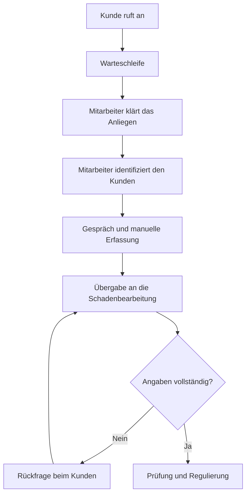
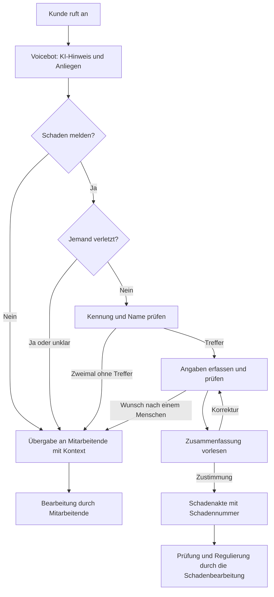

# Prozessanalyse: Kfz-Schadenmeldung (As-Is und To-Be)

| | |
|---|---|
| **Auftraggeber (fiktiv)** | Musterschutz Versicherung AG |
| **Projektart** | Simuliertes Übungsprojekt |
| **Version** | 0.1 |
| **Stand** | 05.11.2026 |
| **Grundlage** | [Anforderungen](01_anforderungen.md), [Dialogdesign](02_dialogdesign.md), [Messungen](03_messungen.md) |

> **Hinweis:** Der Ist-Prozess, die Schwachstellen und das Rechenbeispiel sind Annahmen dieses Übungsprojekts. In einem echten Projekt werden sie in Workshops und mit Daten des Kunden geprüft.

## 1. Ergebnis

Die telefonische Erstmeldung (FNOL) eignet sich für einen Voicebot, weil viele Schritte regelhaft sind und vor allem Angaben erfasst werden. Der Voicebot soll den Kundenservice bei einfachen Meldungen entlasten und vollständigere Daten liefern. Personenschäden, unklare Fälle sowie Deckung und Regulierung bleiben bei Menschen.

**Empfehlung:** Ein Pilot beginnt mit einfachen Kfz-Schäden wie Parkschaden und Glasbruch.

**Betrachteter Abschnitt:** vom Eingang des Anrufs bis zur Übergabe an die Schadenbearbeitung. Die Regulierung selbst gehört nicht zum Umfang.

## 2. Ist-Prozess (As-Is)



| Schritt | Verantwortlich | Angenommene Schwachstelle | Folge |
|---|---|---|---|
| Warteschleife | Telefonie | Zu wenig Kapazität bei Lastspitzen | Lange Wartezeit, Abbrüche |
| Anliegen klären | Kundenservice | Auch einfache Fälle binden Mitarbeitende | Hoher Aufwand |
| Identifikation | Kundenservice | Daten werden manuell gesucht | Längeres Gespräch |
| Erfassung | Kundenservice | Pflichtangaben werden uneinheitlich erfragt | Lücken in der Erstmeldung |
| Übergabe | Kundenservice, Schaden | Angaben werden teils doppelt erfasst | Medienbruch |
| Rückfrage | Schadenbearbeitung | Fehlende Angaben werden nachträglich geklärt | Längere Durchlaufzeit |

## 3. Soll-Prozess (To-Be)



## 4. Automatisierungspotenzial

Bewertet wird nach vier Kriterien: Regelhaftigkeit, Risiko bei Fehlern, Prüfbarkeit im System und Bedarf an menschlichem Urteil.

| Schritt | Soll | Einstufung | Begründung | Stand im Prototyp |
|---|---|---|---|---|
| Begrüßung und KI-Hinweis | Voicebot | Automatisiert | Fester Text | Umgesetzt, Wortlaut stichprobenartig geprüft |
| Anliegen erkennen | Voicebot | Bot mit Prüfung | Anliegen muss tatsächlich genannt sein | Umgesetzt |
| Sicherheitsfrage | Voicebot | Bot mit Prüfung, sonst Mensch | Nur ein klares Nein führt weiter | Umgesetzt, Rückfrage bei Widerspruch |
| Identifikation | Voicebot und CRM | Bot mit Prüfung | Exakte Suche im System | Mit simuliertem CRM |
| Angaben erfassen | Voicebot | Bot mit Prüfung | Werte lassen sich validieren und bestätigen | Umgesetzt |
| Zustimmung zur Zusammenfassung | Anrufer | Pflicht vor der Anlage | Verhindert falsche Akten | Umgesetzt |
| Schadenakte anlegen | System | Automatisiert | Nur nach allen Prüfungen | Umgesetzt |
| Korrektur und Nachbearbeitung | Sachbearbeitung | Mensch | Fachliches Urteil | Umgesetzt, lokale Oberfläche |
| Personenschaden | Mitarbeitende | Mensch | Sensibel und möglicherweise dringend | Übergabe umgesetzt |
| Deckung und Regulierung | Fachabteilung | Mensch | Rechtlich und finanziell verbindlich | Bot macht keine Zusage; noch im Live-Test zu prüfen |

### Eignung nach Fallart

| Fallart | Eignung für den Bot | Vorgehen |
|---|---|---|
| Parkschaden, Glasbruch | Hoch | Vollständige Aufnahme im Pilot |
| Wildschaden | Mittel bis hoch | Nach dem Pilot prüfen, weil eventuell Nachweise nötig sind |
| Unfall mit anderen Beteiligten | Mittel | Aufnahme möglich, Fachbereich klärt die nötigen Zusatzangaben |
| Personenschaden | Keine | Sofortige Übergabe |
| Statusfrage, Beschwerde | Vorerst keine | Übergabe, spätere eigene Use Cases |

## 5. Auswirkungen auf Rollen

| Rolle | Änderung | Nötige Unterstützung |
|---|---|---|
| Kundenservice | Weniger einfache Aufnahmen, mehr anspruchsvolle Gespräche | Übergabeprozess und Schulung |
| Schadenbearbeitung | Strukturierte Akten mit Transkript und Änderungshistorie | Einbindung in die Abnahme der Pflichtfelder |
| Product Owner | Steuert Dialoge und Backlog anhand von Kennzahlen | Dashboard und Testberichte |
| IT | Betreibt Telefonie-, CRM- und Modellanbindung | Architektur und Betriebskonzept |
| Datenschutz, Compliance | Prüft Transparenz, Datenflüsse und Löschfristen | Dokumentation und frühe Einbindung |

## 6. Messung des Nutzens

Vor dem Pilot wird eine Ausgangsbasis aus Telefonie und CRM erhoben. Ohne sie lässt sich der Nutzen nicht belegen.

| Ziel | Kennzahl | Ausgangswert | Prototyp |
|---|---|---|---|
| Wartezeit senken | Mittlere Wartezeit, Abbruch in der Warteschleife | Beim Kunden erheben | Nicht messbar, keine Telefonie |
| Mitarbeitende entlasten | Abschlussquote, Übergabequote | Beim Kunden erheben | Messbar in Testszenarien |
| Datenqualität verbessern | Vollständige Erstmeldungen, Rückfragequote | Beim Kunden erheben | Vollständigkeit prüfbar, Rückfragen nicht |
| Korrektheit sichern | Aufgabenerfolg, Slot-Genauigkeit | Nicht vorhanden | Messbar in Testszenarien |
| Gesprächsqualität sichern | Antwortzeit, Korrekturen je Gespräch | Nicht vorhanden | Teilweise messbar |
| Sicherheit einhalten | Übergabe bei Personenschaden, Deckungszusagen | Nicht vorhanden | Messbar in Testszenarien |

## 7. Rechenbeispiel für den Business Case

Dieses Beispiel zeigt den Rechenweg und ist **keine Prognose**. Alle Eingaben sind frei angenommen.

| Annahme | Wert |
|---|---|
| Schadenmeldungen pro Monat | 1.000 |
| Vom Bot abgeschlossener Anteil | 40 % |
| Eingesparte Gesprächszeit je abgeschlossener Meldung | 8 Minuten |
| Kosten je Mitarbeiterstunde | 35 € |
| Variable Bot-Kosten je abgeschlossener Meldung | 1 € |

```text
Abgeschlossene Meldungen = 1.000 × 40 %          = 400
Eingesparte Zeit         = 400 × 8 Min.          ≈ 53,3 Stunden
Eingesparte Kosten       = 53,3 Std. × 35 €      ≈ 1.867 €
Variable Bot-Kosten      = 400 × 1 €             = 400 €
Monatlicher Effekt       = 1.867 € − 400 €       ≈ 1.467 €
```

Nicht enthalten sind Einführung, Betrieb, Lizenzen, Schulung und Nachbearbeitung. Auch mögliche Nutzen wie kürzere Wartezeiten und weniger Rückfragen fehlen. Eine eingesparte Stunde senkt die Kosten zudem erst, wenn die Kapazität tatsächlich anders eingesetzt wird.

## 8. Risiken

| Risiko | Beobachtung oder Annahme | Gegenmaßnahme |
|---|---|---|
| Falsche Daten in der Akte | Im Live-Test nannte das Modell den Anrufer als Beteiligten | Serverprüfung, ausdrückliche Frage, Zustimmung |
| Akte ohne Zustimmung | Im Live-Test aufgetreten, danach Regel ergänzt | Zustimmung muss im Transkript stehen |
| Fehlerhafte Transkription | „Nein“ wurde einmal als Verletzung geschrieben | Rückfrage bei Widerspruch |
| Reaktion auf Geräusche | Bot meldete ohne Aussage einen Schaden | Entscheidung braucht eine erkannte Aussage |
| Akzente und Hintergrundgeräusche | Noch nicht systematisch geprüft | Testreihe T-09 |
| Geringe Akzeptanz | Annahme | Früh den Menschen als Option anbieten und Rückmeldungen auswerten |
| Fehleinschätzung des Nutzens | Keine echten Ausgangsdaten | Ausgangsbasis vor dem Pilot erheben |

## 9. Offene Fragen an die Fachbereiche

| Stakeholder | Frage |
|---|---|
| Schadenbearbeitung | Welche Angaben fehlen heute am häufigsten, und welche führen zu Rückfragen? |
| Schadenbearbeitung | Sind die neun Pflichtfelder je Schadenart ausreichend? |
| Kundenservice | Wie verteilen sich Anrufe und Lastspitzen nach Uhrzeit und Anliegen? |
| Kundenservice | Welche Informationen braucht das Team bei einer Übergabe? |
| Compliance, Datenschutz | Welche Vorgaben gelten für Transkripte, Löschfristen und Modellanbieter? |
| IT | Welche Telefonie-, CRM- und Schadensysteme müssen angebunden werden? |
| Product Owner | Ab welchen Werten gilt der Pilot als erfolgreich? |

## 10. Vorschlag für den Pilot

1. **Ausgangsbasis erheben:** Wartezeiten, Gesprächsdauer, Fallarten und Rückfragen.
2. **Umfang begrenzen:** Parkschaden und Glasbruch, zunächst in Zeiten mit Lastspitzen oder außerhalb der Servicezeiten.
3. **Mitarbeitende einbeziehen:** Alle Akten im Pilot prüfen, Abweichungen erfassen und Dialoge anpassen.
4. **Erfolgskriterien vorab festlegen:** Die Grenzwerte werden mit den Fachbereichen vereinbart. Für Personenschaden und Deckungszusagen gelten die Ziele NFA-04 und NFA-05.
5. **Über die Ausweitung entscheiden:** Nur auf Basis der gemessenen Werte werden weitere Fallarten aufgenommen.
