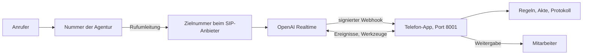

# Telefonie einrichten

Stand: 05.11.2026. Der Code und die Konsole sind mit simulierten Diensten getestet. Die Twilio-Einrichtung lief einmal mit einem echten Testkonto und einer US-Nummer. Ein echter Anruf und eine deutsche Nummer stehen noch aus.

## Ablauf

## Einrichtung über die Konsole

Server starten und im Browser `http://localhost:8000` öffnen. Die Ansicht **Einrichtung** führt durch diese Schritte und schreibt die Werte in `.env`:

| Schritt | Was die Konsole tut | Was außerhalb passiert |
|---|---|---|
| 1. OpenAI-Schlüssel | Prüft den Schlüssel und das Modell | Schlüssel bei OpenAI erstellen |
| 2. Öffentliche Adresse | Erkennt einen ngrok-Tunnel und prüft die Erreichbarkeit | `ngrok http 8001` in einem eigenen Fenster starten |
| 3. Webhook | Zeigt die zu kopierende URL, speichert Projekt-ID und Geheimnis | Webhook bei OpenAI anlegen |
| 4. Deutsche Rufnummer | Twilio: prüft Konto und Freigabe, legt SIP Trunk an. Eigener Trunk: zeigt die SIP-Adresse | Unterlagen einreichen und Nummer kaufen, oder den Trunk beim Anbieter eintragen |
| 5. Mitarbeiter | Prüft die Nummer und verhindert Kreisläufe | – |
| 6. Testanruf | Erkennt angekommene Telefonate im Protokoll | Selbst anrufen |
| 7. Rufumleitung | Zeigt Codes und Zielnummer, vermerkt den Stand | Beim eigenen Telefonanbieter einrichten; bei eigenem Trunk entfällt der Schritt |

Die Konsole kauft keine Rufnummern. Das kostet Geld und verlangt Unterlagen.

## Wege für die deutsche Rufnummer

Der Agent nimmt nur an deutschen Nummern an. Eine US-Nummer aus dem Twilio-Testkonto ist kein Anschluss: Beim Test am 05.11.2026 hat der deutsche Mobilfunktarif den Anruf abgelehnt. Die Konsole schließt ausländische Nummern nicht an.

Im Schritt **Deutsche Rufnummer anschließen** wählt jede Agentur selbst einen Weg. Zwei Fragen ergeben eine Empfehlung, und jeder Weg zeigt Voraussetzungen, Kosten, Grenzen und eine Schritt-für-Schritt-Anleitung mit der eigenen Projekt-ID. Die Inhalte stehen in `src/voice/anschlusswege.py`.

| Weg | Gruppe | Gewerbe | Umleitung | Aufwand | Prüfstand |
|---|---|---|---|---|---|
| Twilio-Ortsnummer | Neue Nummer | Pflicht | Ja | Gering | Konsole richtet die Leitung ein |
| Telnyx-Nummer | Neue Nummer | Nicht nötig | Ja | Mittel | Anbieter beschreibt den Weg zu OpenAI |
| DIDWW-Nummer | Neue Nummer | Offen | Ja | Mittel | Nicht bestätigt |
| Zadarma-Nummer | Neue Nummer | Nicht nötig | Ja | Gering | Nicht bestätigt, TLS klären |
| Anderer SIP-Anbieter | Neue Nummer | Offen | Ja | Mittel | Nicht bestätigt |
| easybell-Trunk | Bestehende Nummer | Offen | Nein | Mittel | Nicht bestätigt |
| Telefonanlage | Bestehende Nummer | Offen | Nein | Mittel | Nicht bestätigt |
| Nummer zu Twilio umziehen | Bestehende Nummer | Pflicht | Nein | Hoch | Konsole richtet die Leitung ein |
| SIP-Brücke | Bestehende Nummer | Offen | Nein | Hoch | Nicht bestätigt |
| 0800 über Twilio | Kostenlose Nummer | Nicht nötig | Nein | Hoch | Konsole richtet die Leitung ein |

"Konsole richtet die Leitung ein" heißt: Twilio-Einrichtung per Schnittstelle, ein echter Anruf aus Deutschland steht auch dort aus.

### Regeln für neue Agenturen

1. Vor dem Termin klären, ob ein Gewerbe vorliegt und wie die Nummer heute angeschlossen ist.
2. Keine ausländische Nummer als Ziel verwenden.
3. Die Mitarbeiternummer darf nicht zum Agenten führen. Ein Handy oder eine Durchwahl nutzen.
4. Zuerst direkt auf die neue Nummer anrufen, dann erst umleiten.
5. Mit Keine Antwort oder Besetzt beginnen. Erst nach stabilem Betrieb immer umleiten.

## Sicherheit

- Port 8000 mit Akten und Einstellungen ist nur lokal erreichbar. Anfragen über eine fremde Adresse lehnt der Server ab.
- Port 8001 bietet nur den Webhook an und nimmt nur Anfragen mit gültiger Signatur an.
- Geheime Werte stehen nur in `.env`. Die Konsole zeigt höchstens die letzten vier Zeichen des OpenAI-Schlüssels.
- Die Anrufernummer wird nicht ins Protokoll geschrieben.
- Ein Gespräch endet spätestens nach 10 Minuten. Die Zahl gleichzeitiger Anrufe ist begrenzt.

## Live-Prüfung

| Nr. | Prüfung | Erwartung |
|---|---|---|
| TL-1 | Anruf auf die Zielnummer | Begrüßung mit KI-Hinweis |
| TL-2 | Vollständige Schadenmeldung | Akte erscheint in der Sachbearbeitung |
| TL-3 | Anrufer legt mitten im Gespräch auf | Gesprächsdatei mit `Ergebnis: Abgebrochen` |
| TL-4 | "Ich möchte einen Menschen sprechen" | Letzter Satz, dann Weitergabe an die zweite Nummer |
| TL-5 | Anruf über Rufumleitung | Gleicher Ablauf; prüfen, welche Nummern ankommen |
| TL-6 | Mehr Anrufe als erlaubt | Besetzt, Eintrag `anruf_abgelehnt` im Protokoll |
| TL-7 | Latenz am Telefon | Mit den Browserwerten vergleichen |
| TL-8 | Anschluss mit echtem Twilio-Konto | Trunk, SIP-Ziel und Nummernzuordnung stimmen in der Twilio-Konsole |

## Offene technische Punkte

- Twilio-Trunks werden ohne `Secure` angelegt, wie in der Twilio-Anleitung. Wenn ein echter Anruf ohne Ton bleibt, ist SRTP als Erstes zu prüfen.
- Für europäische Datenhaltung nennt OpenAI `sip-eu.api.openai.com`. Das ist vor dem Kundenbetrieb zu prüfen und einzustellen.

## Grenzen

- Dieser Stand kennt nur einen Mandanten und läuft auf einem lokalen Rechner. Ist der Rechner oder Tunnel aus, kommt kein Anruf durch. Für Kunden sind Hosting, Mandantentrennung, Anmeldung und ein Ausweichweg nötig.
- Vor echten Kundenanrufen sind Auftragsverarbeitung, Datentransfer und Aufbewahrung rechtlich zu prüfen.
- Der Bot kennt nur die Kfz-Schadenmeldung. Andere Anliegen werden an den Menschen übergeben.
- Name, Begrüßung und Regeln der fiktiven Musterschutz Versicherung stehen im Code.
